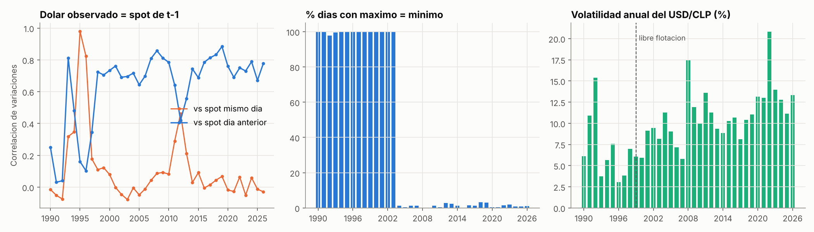
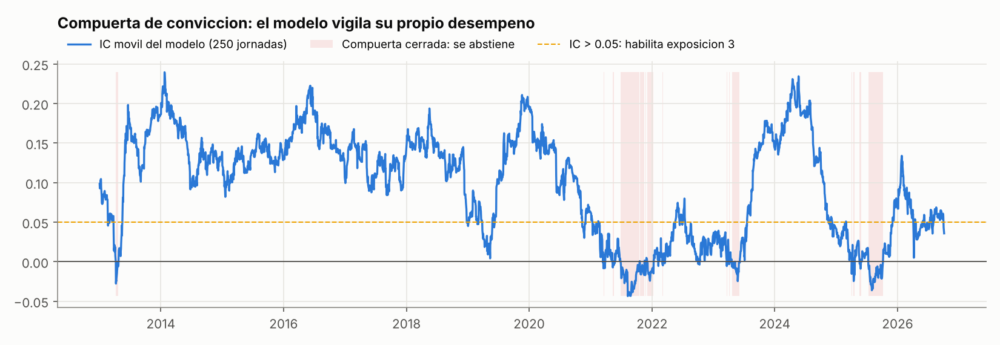
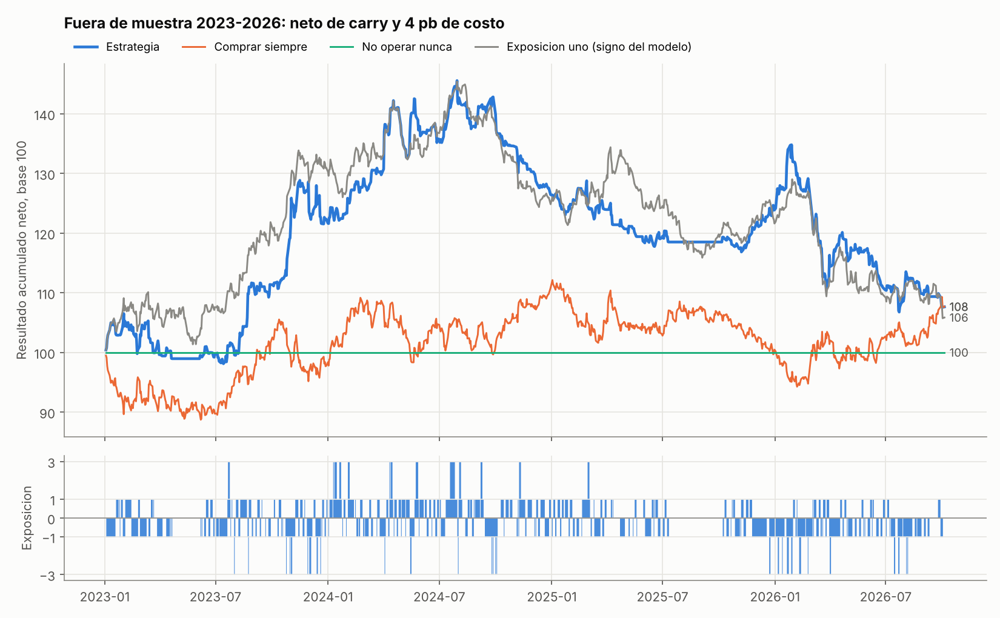
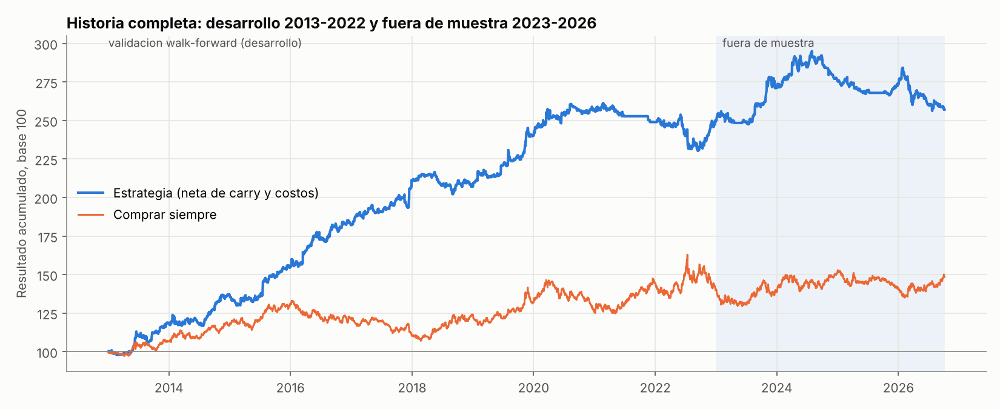
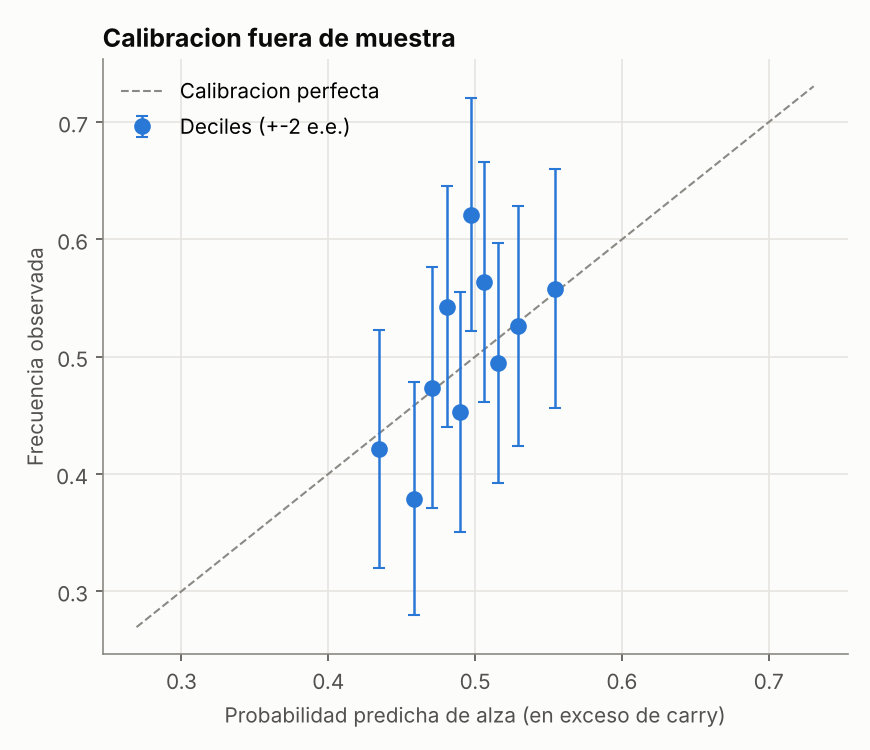
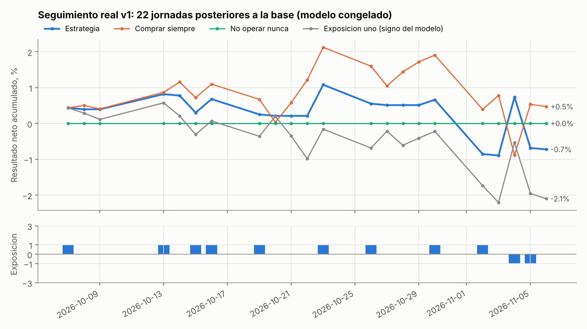
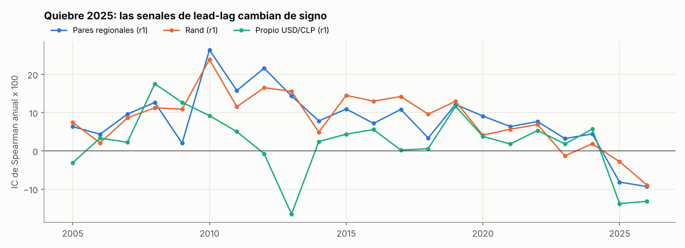
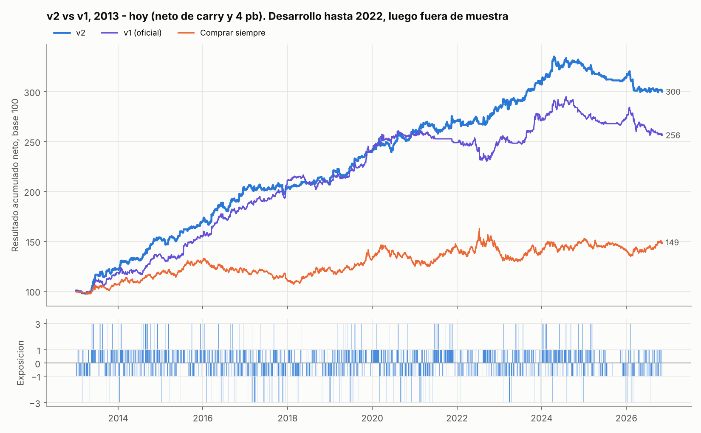

# ¿Sube o baja el dólar mañana? Informe técnico

**Torneo de Trading FEN – Banco Itaú 2026 · Data Science en Finanzas**

Un modelo probabilístico de la dirección del USD/CLP a un día, traducido a exposiciones de −3, −1, 0, +1 o +3 veces el nocional, evaluado neto de carry y costos y con pruebas de significancia.

> **Versión 2 (sección 9).** Tras revisar proyectos públicos y literatura se construyó una v2: regresión sobre el retorno normalizado por volatilidad y gestión por volatilidad, elegida solo con 2013-2022. Fuera de muestra rinde 4,5% anual neto (Sharpe 0,31), contra 2,0% de la v1, y es la versión de producción para el monitoreo en vivo. La v1 sigue siendo la cifra oficial pre-registrada.
>
> **Resumen en una línea (v1).** El pronóstico tiene información real fuera de muestra (AUC 0,55; Diebold-Mariano le gana a la climatología, p = 0,042). La estrategia ganó +8,5% anual bruto en 2023-2026, pero con 4 pb de costo por unidad transada el neto (+2,0% anual) no se distingue estadísticamente de comprar siempre. La regla de convicción sí funciona: los días de exposición máxima rinden 16 pb diarios tanto en desarrollo como fuera de muestra.

---

## 1. Planteamiento

**Objetivo.** Para cada jornada *t* se estima, al cierre, la probabilidad de que el retorno de una posición comprada en dólar entre *t* y *t+1* sea positivo **neto de carry**:

$$y_t = \mathbb{1}\left[\frac{S_{t+1}}{S_t} - 1 - \text{carry}_t > 0\right], \qquad \text{carry}_t = \text{devengo CLP}_{t\to t+1} - \text{devengo USD}_{t\to t+1}$$

Se modela el exceso, no la variación del spot, porque eso es lo que paga la estrategia: una posición comprada paga el carry y una vendida lo recibe.

**Resultado de la jornada** (la misma regla que describen las bases):

$$\text{pnl}_{t+1} = x_t\left(\frac{S_{t+1}}{S_t}-1-\text{carry}_t\right) - c\,|x_t - x_{t-1}|,\qquad x_t\in\{-3,-1,0,1,3\}$$

con *c* = 4 pb por unidad de nocional transada (caso base; se reporta sensibilidad de 0 a 10 pb). El nocional es fijo, así que el resultado acumulado es la suma de los retornos diarios.

**Carry.** Pesos: el cociente del Índice de Cámara Promedio, CLICP<sub>t+1</sub>/CLICP<sub>t</sub> − 1, que es exactamente el interés devengado e incluye fines de semana (antes de nov-2002 se usa la TPM). Dólares: SOFR desde abr-2018 y Fed Funds efectiva antes, Act/360. El LIBOR está descontinuado desde 2024-09 y no se usa.

**Tramos.** Ninguna cifra fuera de muestra se usó para elegir nada de la versión oficial.

| Tramo | Fechas | Uso |
|---|---|---|
| Entrenamiento inicial | 2005-01 → | primera ventana; los modelos se reentrenan cada mes con todo lo anterior |
| Calentamiento del calibrador | 2008-2012 | predicciones fuera de muestra que solo sirven para calibrar |
| **Desarrollo (validación walk-forward)** | 2013-01 → 2022-12 | elegir variables, modelo y reglas de exposición |
| **Fuera de muestra** | 2023-01 → 2026-10-05 | evaluación final, 952 jornadas |
| Monitoreo en vivo | 13-nov → 1-dic 2026 | prueba que nadie ha visto |

---

## 2. Auditoría de la base: las seis preguntas del diccionario

Cada respuesta sale de `scripts/01_auditoria.py` y está en `reports/tables/auditoria_*.csv`.



| # | Pregunta | Hallazgo | Tratamiento |
|---|---|---|---|
| 1 | ¿A qué jornada corresponde el dólar observado? | La variación del observado publicado en *t* tiene correlación **0,73** con la del spot de *t−1* y **0,05** con la del mismo día. | Refleja la jornada anterior. No se usa para el objetivo y es redundante como variable. |
| 2 | ¿Desde cuándo cada serie mide lo que creemos? | Banda cambiaria hasta sep-1999: el 95% de los días de 1990 no hubo variación. | El entrenamiento parte en 2005. |
| 3 | ¿El intradía tiene contenido? | Máximo = mínimo el 100% de los días 1990-2003 y el 1,2% desde 2004. | Las variables de rango solo tienen contenido desde 2004. |
| 4 | ¿Hay quiebres de unidad? | El 2001-08-09, CHON (real, en UF) marca 3,5% y CHOVCHOV (nominal) 6,5%. USDBRL cambia de moneda antes de 1994. El WTI tiene un precio negativo. En los bonos GTCLP, PX_LAST es tasa. | No se empalma CHON con CHOVCHOV. Esas series quedan fuera de la ventana o sin logaritmo. |
| 5 | ¿Qué hacer con los huecos? | 19 saltos de más de 5 días en USDCLP, casi todos entre nov-2011 y oct-2012 (~120 jornadas faltantes). Hay cotizaciones rancias en feriados chilenos. | Calendario = jornadas del USDCLP. Un dato se arrastra hacia adelante como máximo 5 jornadas (una serie muerta queda vacía y no se fabrica un dato viejo). Las jornadas rancias y los saltos anómalos se excluyen del entrenamiento. |
| 6 | ¿El dato estaba disponible cuando lo uso? | La posición de la banca (BCCh) tiene correlación **−0,39** con el retorno *del mismo día*: usarla sin rezago sería fuga pura. La extracción la trae hasta un día antes que el resto. La macro sale con ~8 días (IPC) a ~34 días (IMACEC) de rezago. | Flujos con 2 jornadas de rezago. SOFR y Fed Funds con 1. La macro se ubica en su `FECHA_RELEASE` (y donde falta, se asume el máximo rezago observado más una holgura). |

Además se empalma la posición de la banca vieja (2008-2023) con la nueva (2022+). En las 291 jornadas de traslape las dos tienen correlación de niveles de 0,998 y razón mediana de 1,01, así que miden lo mismo.

**Control de fuga automatizado.** `tests/test_sin_fuga.py` trunca la base en tres fechas y reconstruye todas las variables. Lo que corresponde a fechas anteriores al corte debe salir idéntico al cálculo con la base completa. También verifica que la compuerta de convicción no reacciona a retornos aún no realizados, y que la fila del día en producción (la última de la base) es idéntica a la que se calcula después con historia posterior. Las pruebas detectaron, y llevaron a corregir, dos errores:

* **Empalme de flujos.** Con una base cortada antes de 2022, la serie nueva venía vacía y el empalme descartaba también la antigua.
* **Variable de fin de mes.** Se detectó al incorporar datos posteriores a la base. En la última fila la jornada siguiente aún no existe y la variable quedaba marcada como fin de mes. No afectaba el backtest, donde la jornada siguiente siempre se conoce, pero sí habría afectado cada señal en vivo. Ahora se usa el siguiente día hábil, que se conoce de antemano.

---

## 3. Variables

El conjunto núcleo, 31 variables definidas por razonamiento económico, está en `pipeline.CORE_FEATURES`:

| Bloque | Variables | Idea |
|---|---|---|
| Dinámica propia | retornos 1 y 5 días, retorno estandarizado, distancia a la media de 20 días, ubicación del cierre en el rango, rango intradía, razón de volatilidades | momentum y reversión de corto plazo |
| Pares y dólar global | USD/BRL, USD/MXN, USD/ZAR, canasta de pares, BBDXY, residuo del CLP contra pares | información que llega después del cierre de Santiago |
| Cobre y commodities | cobre COMEX y LME (1 y 5 días), oro | términos de intercambio |
| Riesgo | VIX, S&P 500, EM-VXY, vol implícita USDCLP 1M, prima de volatilidad | apetito por riesgo |
| Tasas y carry | diferencial swap CLP 2a − Tesoro 2a, base NDF (rendimiento implícito − TPM), cambio en puntos NDF, Tesoro 2a, TPM − tasa USD | carry y presión offshore |
| Flujos | posición offshore de la banca (rezagada) | posicionamiento |
| Calendario | día de la semana, fin de mes | rebalanceos |

**La ventaja horaria, declarada.** Las variables más informativas son los cierres de Nueva York del mismo día (rand, peso mexicano, real, DXY, VIX), con un IC de Spearman de 0,08 a 0,11 contra el exceso del día siguiente en 2005-2022. El USD/CLP cierra con la sesión de Santiago y esas series cierran horas después, así que contienen información que el peso todavía no incorporó. Las bases lo autorizan expresamente ("los valores de cierre de una misma fecha están todos disponibles al momento de decidir"). Se reporta igual una **prueba de robustez en horario estricto** que rezaga un día toda serie que cierra después de Santiago. En esa versión la ventaja desaparece (sección 6). Es decir: la estrategia vive de esa ventana y lo decimos de frente.

---

## 4. Modelo y regla de decisión

### 4.1 Probabilidad

* **Ensamble** de una regresión logística con penalización L2 (C = 0,005, variables estandarizadas y winsorizadas al 0,5%) y un gradient boosting poco profundo (LightGBM, profundidad 3, 150 observaciones mínimas por hoja, 3 semillas). La logística aporta estabilidad y el boosting capta no linealidades.
* **Reentrenamiento mensual** con ventana expansiva, un **embargo** de 5 jornadas entre el fin del entrenamiento y el inicio de la predicción (López de Prado, cap. 7) y **pesos por antigüedad** con vida media de 3 años, para que el modelo se adapte a cambios de régimen.
* **Calibración** por *temperature scaling* (Platt sin intercepto), ajustada solo con predicciones fuera de muestra anteriores al mes que se calibra. El intercepto se omite a propósito. La primera versión lo tenía, y absorbía la frecuencia base del período (el exceso es negativo algo más seguido por el carry), corría el centro bajo 0,5 e invertía el signo de las predicciones débiles. En desarrollo eso dejaba el quintil de menor convicción con 45% de acierto.

### 4.2 De la probabilidad a la exposición (`strategy.py`)

Las bases ponen la dificultad en *discriminar cuándo tomar posición y cuándo abstenerse*. La regla tiene cuatro capas, y todos sus umbrales usan solo información anterior a la decisión:

1. **Suavizado.** La ventaja *p* − 0,5 se promedia con una EMA de 3 jornadas. La señal diaria es ruidosa y cada cambio de posición paga costo. Sin suavizado, en desarrollo la rotación es de 214 veces el nocional al año y el costo se come la mitad del Sharpe bruto (1,48 → 0,77).
2. **Abstención por baja convicción.** Si |ventaja| está bajo su percentil 20 de las últimas 250 jornadas, la posición es 0.
3. **Compuerta de convicción (meta-labeling, López de Prado cap. 3).** El modelo vigila su propio desempeño: si la correlación entre su ventaja predicha y el exceso realizado en las últimas 250 jornadas no es positiva, se abstiene.
4. **Exposición máxima con doble condición.** ±3 solo si la convicción está en el 10% superior **y** el IC reciente del modelo supera 0,05. Triplicar exige convicción hoy y evidencia de que el modelo ha estado acertando.



### 4.3 Cómo se eligieron los parámetros

`scripts/03_grilla_desarrollo.py` evalúa 174 configuraciones de la regla, solo en 2013-2022. La elegida (suavizado 3, q1 = 0,2, exposición máxima en el percentil 90 con IC > 0,05, compuerta de 250 jornadas) es la de mayor Sharpe neto de desarrollo (1,09). No es un pico aislado: está en una meseta donde las vecinas (suavizado 2-5, q1 0-0,3, IC 0,05-0,10) rinden entre 0,86 y 1,06.

Las pruebas de modelo y de variables previas a la grilla se descartaron por resultados de desarrollo:

| Prueba | Resultado en desarrollo | Decisión |
|---|---|---|
| Todas las variables (130) | AUC 0,51-0,52 y log-loss peor que la referencia sin información | se descarta, demasiado ruido |
| Coeficientes de lead-lag adaptativos | empeoran el Sharpe ±1 de 0,60 a 0,35 | se descartan |
| Vida media de 3 años vs ∞ vs 1,5 | 3 años es lo mejor para el ensamble | 3 años |

Con todo, el Deflated Sharpe usa **400 ensayos**, una cifra conservadora.

---

## 5. Resultados fuera de muestra (2023-01-02 → 2026-10-05, 952 jornadas)



| | Retorno anual bruto | **Retorno anual neto** | Sharpe neto | Máx. drawdown | Días activos | Rotación anual |
|---|---:|---:|---:|---:|---:|---:|
| **Estrategia** | 8,5% | **2,0%** | 0,14 | −38,8% | 70% | 163× |
| Comprar siempre | 2,0% | 2,0% | 0,16 | −17,9% | 100% | 0× |
| No operar nunca | 0,0% | 0,0% | – | 0,0% | 0% | 0× |
| Exposición uno (signo del modelo, sin capas de convicción) | 10,1% | 1,6% | 0,12 | −39,7% | 100% | 215× |

**Por año (neto, % del nocional):** 2023 **+22,4** · 2024 **+4,1** · 2025 **−2,6** · 2026 **−16,2** (hasta el 5-oct).

**Desarrollo 2013-2022, como referencia:** 15,0% neto anual, Sharpe 1,09, positivo en 8 de 10 años.



### 5.1 Significancia estadística

**Calidad del pronóstico (Diebold-Mariano sobre la pérdida de Brier, corrección de Harvey-Leybourne-Newbold, varianza Newey-West):**

| Comparación | DM | p (una cola) |
|---|---:|---:|
| Modelo vs probabilidad 0,5 (sin información) | 1,49 | 0,069 |
| Modelo vs climatología (frecuencia base histórica) | 1,73 | **0,042** |

AUC fuera de muestra: 0,551. Acierto direccional: 53,3%. Log-loss: 0,6896, contra 0,6931 sin información. El pronóstico agrega información significativa al 5% frente a la climatología y al 10% frente a la moneda al aire.

**Resultado de la estrategia (bootstrap estacionario de Politis-Romano, 5.000 remuestreos, bloque medio de 10 días):**

| vs | Diferencia de retorno anual | IC 95% | p-valor |
|---|---:|---:|---:|
| Comprar siempre | 0,0 pp | [−21,6; +22,8] | 0,50 |
| No operar nunca | +2,0 pp | [−13,1; +18,2] | 0,41 |
| Exposición uno | +0,5 pp | [−9,8; +11,0] | 0,46 |

IC 95% del Sharpe de la estrategia: [−0,96; 1,23]. Probabilistic Sharpe vs 0: 0,61. **Deflated Sharpe: 0,15**, con un umbral de Sharpe de 0,68 para 400 ensayos.

**Lectura honesta.** Neta de 4 pb, la estrategia **no supera significativamente** a ninguna referencia fuera de muestra. El pronóstico sí es significativo. La brecha entre ambos la explican los costos y el tramo 2025-2026 (sección 6).

### 5.2 Sensibilidad a costos

| Costo por unidad transada | 0 pb | 2 pb | **4 pb** | 6 pb | 10 pb |
|---|---:|---:|---:|---:|---:|
| Retorno anual neto | 8,5% | 5,3% | **2,0%** | −1,2% | −7,7% |
| Sharpe neto | 0,60 | 0,37 | **0,14** | −0,09 | −0,54 |

El costo es el parámetro que más mueve el resultado. **Hay que correr la estrategia con el costo del código oficial del laboratorio** (ver README).

### 5.3 Lectura de la convicción



| Nivel de exposición | Jornadas OOS | Acierto de la señal | Ventaja de la señal (pb/día, ×1) | Resultado neto | Desarrollo: ventaja (pb/día) |
|---|---:|---:|---:|---:|---:|
| 0 (abstención) | 285 (30%) | 53,3% | 3,8 | −5,2%* | 1,5 |
| 1 | 606 (64%) | 49,5% | 0,4 | −13,2% | 7,2 |
| **3 (máxima)** | 61 (6%) | **59,0%** | **16,2** | **+26,0%** | 16,5 |

\* En las jornadas de abstención el resultado neto es el costo de salir de la posición.

* **La exposición máxima es el componente más sólido de la estrategia.** Tanto en desarrollo como fuera de muestra captura ~16 pb diarios, el doble que cualquier otro nivel, y explica todo el resultado positivo 2023-2026. El detalle de cada una de las 61 jornadas está en `reports/tables/jornadas_maxima_exposicion.csv`.
* **La abstención funcionó en desarrollo y no fuera de muestra.** En 2013-2022 los días en que el modelo se abstuvo tenían una ventaja (1,5 pb) menor que el costo de operarlos: abstenerse era lo correcto. En 2023-2026 la compuerta cerró 114 jornadas y la baja convicción otras 171, y en esas jornadas la señal habría ganado ~11%. El costo de la prudencia se pagó sobre todo en 2025, cuando la compuerta estuvo cerrada el 29% de las jornadas.

### 5.4 Seguimiento real: jornadas posteriores a la base

La base original del laboratorio termina el 6-oct-2026. Con la base actualizada que entregó el laboratorio (hasta el 6-nov-2026) se evaluaron las **22 jornadas siguientes**, del 7-oct al 6-nov. Son datos que no existían cuando se congelaron el modelo y la regla. La base nueva es idéntica a la original hasta el 6-oct; solo agrega datos publicados después. Además, ninguna predicción ya emitida cambia al incorporarla (`scripts/06_seguimiento.py` lo verifica). La base original queda archivada como `data/raw/base_usdclp_20261007.xlsx`, y las cifras oficiales 2023-2026 siguen siendo exactamente las mismas.



| 22 jornadas, 7-oct al 6-nov | Resultado neto | Días operados |
|---|---:|---:|
| **Estrategia** | **−0,72%** | 11 (55% de acierto) |
| Comprar siempre | +0,47% | 22 |
| No operar nunca | 0,00% | 0 |
| Exposición uno (signo del modelo, sin capas de convicción) | −2,10% | 22 |

Con 22 jornadas no hay potencia estadística. Lo que sí se observa:

* **El resultado lo definen tres jornadas de alta volatilidad a inicios de noviembre.** El 2-nov la estrategia estaba comprada y el dólar cayó 152 pb. El 4-nov estaba vendida y cayó 167 pb (+163 pb). El 5-nov estaba vendida y subió 142 pb.
* **La capa de convicción siguió agregando valor frente a operar siempre** (+1,4 pp contra la exposición uno). La señal acertó la dirección solo el 45% de las jornadas, pero en las 11 que la estrategia eligió operar acertó el 55%.
* **El IC reciente del modelo bajó de 0,056 a 0,040**, bajo el umbral de 0,05, así que la exposición ×3 no se activa. La regla está haciendo lo que debe: no triplica mientras el modelo no demuestre que está acertando.
* **El circuito de producción funcionó de punta a punta** con dos bases nuevas: la descarga propia del terminal y la base actualizada del laboratorio.
* También confirma con datos dos supuestos de disponibilidad. En la base del 6-nov, la posición de la banca llega hasta el 4-nov (2 jornadas de rezago, el usado en el modelo) y SOFR y Fed Funds hasta el 5-nov (1 jornada).

El detalle día a día está en `reports/tables/seguimiento_diario_v1.csv` (y `_v2` para la versión 2, sección 9).

---

## 6. Qué aprendimos del fuera de muestra

> Esta sección es **post-hoc**: se escribió después de mirar 2023-2026. No cambia la estrategia oficial ni sus cifras. La dejamos porque reportar lo que no funcionó es parte del rigor que piden las bases (`scripts/05_analisis_posthoc.py`).

**Quiebre de 2025 en la microestructura del cierre.** Las señales de lead-lag tuvieron un IC positivo todos los años entre 2005 y 2024, y en 2025-2026 cambian de signo. Al mismo tiempo la autocorrelación diaria del USD/CLP pasa de ~0 a −0,12/−0,15, la correlación con el MXN del mismo día sube de ~0,4 a 0,65 y la del día anterior se va a cero. El patrón es consistente con que el cierre del CLP en la base se acercó en horario al de Nueva York: si el peso ya incorpora la información de esas horas, deja de haber algo que anticipar.



El quiebre ya era visible en la auditoría exploratoria de la base completa. Lo declaramos: ese conocimiento motivó usar pesos por antigüedad y la compuerta de convicción, pero todos sus parámetros numéricos se fijaron con 2013-2022.

**La pérdida de 2026 es un sesgo de nivel, no de timing.** En 2026 el IC diario de la señal es ~0 (no negativo), pero la estrategia estuvo **vendida el 68% de los días** mientras el dólar subía 7,2% en exceso de carry. Las variables lentas (base NDF, diferencial de tasas, distancia a la media) arrastran una apuesta direccional persistente, y en 2026 fue la equivocada.

| Variante post-hoc | Desarrollo: retorno / Sharpe | Fuera de muestra: retorno / Sharpe |
|---|---:|---:|
| **Oficial (v1)** | 15,0% / 1,09 | 2,0% / 0,14 |
| Sin sesgo direccional (ventaja menos su media de 250 días) | 12,8% / 0,87 | 5,9% / 0,46 |
| Sin sesgo direccional (media de 60 días) | 12,7% / 0,86 | 6,2% / 0,42 |
| Memoria corta (vida media 0,5 años) | 5,8% / 0,53 | 2,1% / 0,15 |
| Combinación por desempeño reciente (Pesaran-Timmermann) | 9,3% / 0,72 | 2,4% / 0,18 |

* Acortar la memoria o combinar modelos **no** ayuda: la señal no se invirtió de forma estable, solo se debilitó.
* Quitar el sesgo direccional mejora el fuera de muestra pero empeora el desarrollo, así que no domina. Elegirlo ahora sería ajustar al tramo de prueba. Si la pareja decide adoptarlo para el monitoreo en vivo, debe declararlo como v2 diseñada después de ver el OOS.

**Robustez de las capas (ablación, fuera de muestra):**

| | OOS retorno / Sharpe | Desarrollo retorno / Sharpe |
|---|---:|---:|
| Final | 2,0% / 0,14 | 15,0% / 1,09 |
| Sin compuerta | 4,2% / 0,29 | 15,6% / 1,11 |
| Sin suavizado | 2,9% / 0,20 | 5,4% / 0,40 |
| Sin exposición 3 | −1,5% / −0,13 | 10,6% / 1,03 |
| Sin abstención | 3,0% / 0,20 | 15,3% / 1,04 |

**Horario estricto:** −2,1% anual y Sharpe −0,15 fuera de muestra (−5,0% en desarrollo). Toda la ventaja depende de la ventana Santiago → Nueva York, permitida por las bases.

---

## 7. Limitaciones

1. **Costos y convención de cálculo supuestos.** El código oficial de evaluación no estaba disponible al construir este repositorio. Se supusieron 4 pb por unidad transada, cierre contra cierre y carry de cámara menos SOFR. `backtest.run` está aislado para reemplazarlo por la regla oficial.
2. **Interpretación de las referencias.** "Operar siempre con exposición uno" se implementó como el signo del modelo con intensidad constante, lo que aísla el aporte de la capa de convicción. Si el laboratorio la define distinto, se cambia en `scripts/04_evaluar_oos.py`.
3. **Revisión de datos macro.** La base trae el valor ya revisado. Ubicarlo en su fecha de publicación elimina la fuga por rezago, no la fuga por revisión. El peso de la macro en el modelo es bajo.
4. **Dependencia horaria.** Si en producción los cierres de Nueva York no estuvieran disponibles al decidir, la estrategia no tiene ventaja.
5. **Muestra fuera de muestra corta y con un quiebre.** 952 jornadas con un cambio de régimen en el medio. Los intervalos de confianza son amplios.

---

## 8. Reproducibilidad

```
pip install -r requirements.txt
python run_all.py            # todo (~15 min): auditoría → predicciones → grillas → evaluaciones → seguimiento → señal del día
python run_all.py --rapido   # solo la estrategia de producción y sus estadísticas (~5 min)
python -m pytest tests       # pruebas anti-fuga
```

El notebook `Backtest_USDCLP.ipynb` resume el backtest y se puede ejecutar directamente. Las semillas son fijas (`config.RANDOM_STATE = 42`).

---

## 9. Versión 2: lo que aprendimos de otros proyectos

> **Declaración.** La v2 se diseñó *después* de conocer el fuera de muestra de la v1. Para no ajustar al tramo de prueba: (1) las ideas vienen de una revisión de proyectos públicos y literatura, no de mirar 2023-2026; (2) la elección entre candidatas se hizo **solo con 2013-2022**; (3) 2023-2026 se evaluó una sola vez. Aun así, su cifra fuera de muestra es menos limpia que la de la v1. La prueba limpia de la v2 es el seguimiento posterior y el monitoreo en vivo.

### 9.1 Revisión

| Fuente | Lección |
|---|---|
| Pronóstico de criptomonedas con LightGBM, walk-forward con embargo y Deflated Sharpe ([derinteke/crypto-cross-sectional-forecasting](https://github.com/derinteke/crypto-cross-sectional-forecasting)) | "El IC premia acertar la mediana, pero el portafolio gana la media": conviene modelar la magnitud, no solo el signo. Suavizar la señal 3 días subió su Sharpe neto de 1,12 a 1,45 (lo mismo que encontramos en la v1). Controles nulos con etiquetas barajadas. Su Deflated Sharpe tampoco es significativo. |
| Dirección del oro en euros con stacking y validación con purga ([ORD1STAR/xau-price-predictor](https://github.com/ORD1STAR/xau-price-predictor)) | Filtro de acuerdo entre modelos. Su mejor resultado (AUC 0,63) lo atribuye su propio autor a cierres desalineados entre series, el mismo fenómeno horario que declaramos en la sección 3. |
| Moreira y Muir (2017), *Volatility-Managed Portfolios* | Reducir la exposición cuando la volatilidad está alta mejora la razón retorno/riesgo. |
| Basnarkov et al. (2019), *Lead-lag relationships in FX markets* | El lead-lag entre monedas existe a escala de minutos; a escala diaria solo aparece por desfases horarios de cierre, como el nuestro. |

### 9.2 Candidatas y selección (solo desarrollo)

`scripts/07_v2_seleccion.py` evalúa 18 combinaciones en 2013-2022: 3 modelos base (clasificador v1, regresión sobre el retorno en exceso dividido por la volatilidad de 20 días y acotado a ±4 desvíos con Ridge + LightGBM con pérdida de Huber, o el promedio de ambos) × filtro de acuerdo (sí/no) × gestión por volatilidad (ninguna / sin ×3 sobre el percentil 80 / además fuera del mercado sobre el percentil 95).

Las dos mejoras son consistentes en toda la grilla, no un óptimo aislado:

* **La regresión le gana al clasificador en todas sus variantes** (Sharpe de desarrollo 1,18-1,37 contra 1,02-1,17).
* **La gestión por volatilidad mejora a los tres modelos** (clasificador 1,09 → 1,17; regresión 1,25 → 1,37; combinado 1,06 → 1,24).
* El filtro de acuerdo no ayuda y se descarta.

La elegida: regresión + sin ×3 sobre el percentil 80 de volatilidad + fuera del mercado sobre el percentil 95. El resto de la regla (suavizado, abstención, compuerta, condición del ×3) es idéntico a la v1.

### 9.3 Resultados (`scripts/08_v2_evaluar.py`)



| | Desarrollo 2013-2022 | Fuera de muestra 2023 - 5-oct-2026 | Seguimiento 7-oct - 6-nov (22 días) |
|---|---:|---:|---:|
| **v2** | 18,5% anual, Sharpe 1,37, DD −13,9% | **4,5% anual, Sharpe 0,31**, DD −35,9% | −1,2% |
| v1 (oficial) | 15,0% anual, Sharpe 1,09, DD −31,1% | 2,0% anual, Sharpe 0,14, DD −38,8% | −0,7% |
| Comprar siempre | 4,1% anual | 2,0% anual | +0,5% |
| Exposición uno | 9,2% anual | 1,6% anual | −2,1% |

**Por año (v2, neto):** positiva todos los años 2013-2024, incluidos 2023 (+24,2%) y 2024 (+16,2%) fuera de muestra. En 2025 (−10,5%) y 2026 (−14,3%) pierde, igual que la v1: es el quiebre de la sección 6. Desde 2025 el cierre del peso ya incorpora lo que pasa en Nueva York, y la ventaja horaria se achicó.

**Significancia (2023-2026).**

| v2 contra | Diferencia de retorno anual | p bootstrap | p Diebold-Mariano |
|---|---:|---:|---:|
| Comprar siempre | +2,5 pp | 0,40 | 0,41 |
| No operar nunca | +4,5 pp | 0,28 | 0,28 |
| Exposición uno | +2,9 pp | 0,33 | 0,34 |
| v1 | +2,5 pp | 0,33 | 0,34 |

Ninguna diferencia es significativa.

**Alfa y beta contra comprar siempre** (Newey-West, 2023-2026):

| | Alfa anual | t del alfa | Beta |
|---|---:|---:|---:|
| v2 | 4,9% | 0,63 | −0,18 |
| v1 | 2,8% | 0,37 | −0,38 |

La v2 depende menos de una apuesta direccional persistente (beta −0,18, contra −0,38 de la v1): justo el problema diagnosticado en la sección 6.

**Control nulo** (mismo pipeline con etiquetas barajadas en cada reentrenamiento): AUC 0,48 en desarrollo y 0,50 fuera de muestra, retorno ~0. El pipeline no fabrica ventaja donde no la hay.

### 9.4 Decisión

* **Cifra oficial del fuera de muestra: v1** (pre-registrada, sección 5).
* **Versión de producción para el monitoreo en vivo: v2.** Es mejor en desarrollo, en fuera de muestra, en drawdown de desarrollo y en dependencia direccional, y no es peor en ningún criterio elegido de antemano. El seguimiento de 22 días es levemente peor que el de la v1, pero con 22 jornadas eso no distingue nada.
* **Riesgo principal declarado:** ambas versiones pierden en el régimen 2025-2026. Si la ventaja horaria no vuelve, la compuerta de convicción cerrará la operación cuando el IC del modelo deje de ser positivo (hoy está en 0,04).

---

## Referencias

* López de Prado, M. (2018). *Advances in Financial Machine Learning*. Wiley. Caps. 3 (meta-labeling), 7 (validación con purga y embargo), 14 (Deflated Sharpe).
* Hilpisch, Y. (2020). *Python for Algorithmic Trading*. O'Reilly.
* Diebold, F. y Mariano, R. (1995). Comparing predictive accuracy. *JBES*. · Harvey, D., Leybourne, S. y Newbold, P. (1997). Testing the equality of prediction mean squared errors. *IJF*.
* Politis, D. y Romano, J. (1994). The stationary bootstrap. *JASA*.
* Bailey, D. y López de Prado, M. (2014). The Deflated Sharpe Ratio. *Journal of Portfolio Management*.
* Pesaran, M. H. y Timmermann, A. (2007). Selection of estimation window in the presence of breaks. *Journal of Econometrics*.
* Guo, C. et al. (2017). On calibration of modern neural networks (temperature scaling). *ICML*.
