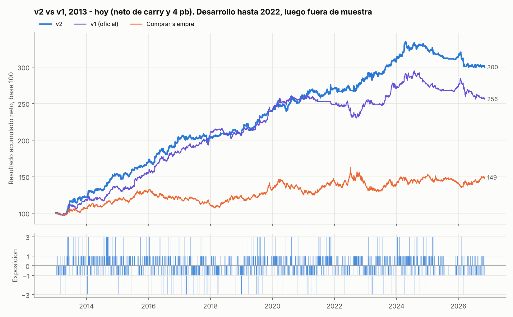

# USD/CLP: ¿sube o baja el dólar mañana?

**Autores:** Benjamín Pavez y Cesar Ahumada

Estrategia direccional de un día sobre el USD/CLP para el **Torneo de Trading FEN – Banco Itaú 2026**. Cada jornada, al cierre, un modelo estima cuánto se moverá el dólar en exceso de carry. Una regla de convicción traduce esa estimación en una exposición de −3, −1, 0, +1 o +3 veces el nocional, que se mantiene hasta el cierre siguiente.

| Entregable | Dónde |
|---|---|
| 1. Cómo ejecutar el proyecto | [sección 1](#1-cómo-ejecutarlo-paso-a-paso) |
| 2. Notebook con el backtest | [`Backtest_USDCLP.ipynb`](Backtest_USDCLP.ipynb) |
| 3. Modelos y supuestos | [sección 3](#3-modelos-y-supuestos) |
| 4. Mecanismo de ejecución | [sección 4](#4-mecanismo-de-ejecución) |
| Informe técnico completo | [`INFORME.md`](INFORME.md) |



---

## 1. Cómo ejecutarlo paso a paso

### Requisitos

* **Python 3.10 a 3.13** (probado con 3.13).
* **La base del laboratorio** (`base_usdclp.xlsx`, hoja `datos`). No viene en el repositorio porque los datos son de Bloomberg.

### Instalación

**Windows (PowerShell o CMD):**

```bat
git clone https://github.com/bpavezv-colab/Challenge-USD-CLP.git
cd Challenge-USD-CLP
python -m venv .venv
.venv\Scripts\activate
pip install -r requirements.txt
```

**macOS / Linux:**

```bash
git clone https://github.com/bpavezv-colab/Challenge-USD-CLP.git
cd Challenge-USD-CLP
python3 -m venv .venv
source .venv/bin/activate
pip install -r requirements.txt
```

### Alternativa sin Git: descargar el ZIP (Windows)

1. **Descargar el proyecto.** En la página del repositorio: botón verde **Code → Download ZIP**.
2. **Descomprimir.** Clic derecho sobre `Challenge-USD-CLP-main.zip` → **Extraer todo**. Entra a la carpeta `Challenge-USD-CLP-main`; si adentro hay otra carpeta con el mismo nombre, entra también a esa. Estás en el lugar correcto si ves `README.md`, `run_all.py` y `requirements.txt`.
3. **Abrir la consola en esa carpeta.** En el Explorador de Windows, haz clic en la barra de direcciones, escribe `cmd` y presiona Enter.
4. **Verificar Python.** Escribe `py --version`. Debe mostrar Python 3.10 o superior. Si da error, instala Python 3.12 desde [python.org/downloads](https://www.python.org/downloads/), marca **"Add python.exe to PATH"** en el instalador y vuelve a abrir la consola.
5. **Crear el entorno e instalar dependencias:**
   ```bat
   py -m venv .venv
   .venv\Scripts\activate
   python -m pip install --upgrade pip
   pip install -r requirements.txt
   ```
   Tras `activate`, la línea empieza con `(.venv)`.
6. **Copiar la base** del laboratorio a `data\raw\base_usdclp.xlsx` (nombre exacto).
7. **Ejecutar:**
   ```bat
   python run_all.py --rapido
   ```
   Al terminar, la señal del día queda en `reports\senal_del_dia.json` y las estadísticas en `reports\tables`. Para el notebook: `jupyter notebook Backtest_USDCLP.ipynb` → *Kernel → Restart & Run All*.

> Si cierras la consola, al volver ábrela en la misma carpeta y ejecuta `.venv\Scripts\activate` antes de cualquier comando.

### Datos

Copia la base del laboratorio en **`data/raw/base_usdclp.xlsx`** (con ese nombre exacto).

### Ejecución

| Qué | Comando | Tiempo |
|---|---|---|
| Estrategia de producción y sus estadísticas | `python run_all.py --rapido` | ~5 min |
| Todo: auditoría, modelos, grillas, pruebas, robustez | `python run_all.py` | ~15 min |
| Notebook del backtest | `jupyter notebook Backtest_USDCLP.ipynb`, luego *Kernel → Restart & Run All* | ~3 min la primera vez |
| Señal del día (al cierre, con la base actualizada) | `python scripts/senal_del_dia.py` | ~1 min |
| Pruebas anti-fuga | `python -m pytest tests` | ~10 s |

El notebook se puede abrir directamente, sin correr `run_all.py` antes: si no encuentra las predicciones, las genera.

### Qué produce

* `reports/senal_del_dia.json`: la decisión para la próxima jornada (dirección esperada, probabilidad, exposición y motivo).
* `reports/posiciones_v2.csv`: **la decisión de cada jornada desde 2013**, con probabilidad, umbrales, IC del modelo, compuerta, estado de volatilidad, exposición, motivo y resultado. Sirve para comparar día a día con el monitor del laboratorio.
* `reports/tables/*.csv` y `reports/figures/*.png`: métricas, pruebas estadísticas y gráficos.

### Con una base nueva (monitoreo en vivo)

Reemplaza `data/raw/base_usdclp.xlsx` por la base actualizada, o pásala como argumento:

```bash
python scripts/senal_del_dia.py ruta/a/base_actualizada.xlsx
```

Como alternativa, se puede descargar desde el terminal Bloomberg con `data/raw/plantilla_bloomberg_usdclp.xlsx`, guardarla en `data/raw/actualizaciones/actualizacion_hasta_AAAAMMDD.xlsx` y correr el mismo comando. Las instrucciones están dentro de la plantilla.

---

## 2. Notebook del backtest

[`Backtest_USDCLP.ipynb`](Backtest_USDCLP.ipynb) viene ejecutado y trae:

* **Estadísticas de trading netas de carry y costos**, para la estrategia y las tres referencias (comprar siempre, no operar nunca, exposición uno): retorno neto total y anual, retorno bruto, volatilidad, Sharpe, drawdown máximo, % de aciertos, número de operaciones, días con posición y costos. Se reportan en tres períodos: desarrollo 2013-2022, fuera de muestra 2023-2026 y seguimiento posterior a la base original.
* **Sensibilidad al costo de transacción.**
* **Gráficos:** resultado acumulado y exposición diaria, drawdown y retorno por año.
* **Lectura de la convicción:** resultado según el nivel de exposición y motivo de cada abstención.
* **Significancia:** Diebold-Mariano, bootstrap estacionario y alfa/beta.
* **Señal del día.**

**Resultado fuera de muestra (2023-01-02 a 2026-10-05, 952 jornadas, neto de carry y 4 pb):**

| | Retorno neto anual | Volatilidad | Sharpe | Máx. drawdown | % aciertos | Operaciones |
|---|---:|---:|---:|---:|---:|---:|
| **v2 (producción)** | **4,50%** | 14,5% | **0,31** | −35,9% | 52,2% | 438 |
| v1 (oficial) | 2,03% | 14,2% | 0,14 | −38,8% | 50,4% | 424 |
| Comprar siempre | 2,03% | 12,8% | 0,16 | −17,9% | 50,4% | 1 |
| No operar nunca | 0,00% | 0,0% | – | 0,0% | – | 0 |
| Exposición uno | 1,55% | 12,8% | 0,12 | −39,7% | 53,4% | 406 |

* En desarrollo (2013-2022) la v2 rinde 18,5% anual neto (Sharpe 1,37) y es positiva los 10 años.
* Fuera de muestra gana en 2023 (+24%) y 2024 (+16%), y pierde en 2025-2026: desde 2025 cambió la microestructura del cierre del peso (ver `INFORME.md`, sección 6).
* **Ninguna diferencia frente a las referencias es estadísticamente significativa** (p de 0,28 a 0,41). El control nulo con etiquetas barajadas da AUC 0,49 y retorno ~0, así que el pipeline no fabrica señal.

---

## 3. Modelos y supuestos

### Modelos y cómo se combinan

| Modelo | Qué hace |
|---|---|
| **Regresión Ridge** | modelo lineal regularizado. Predice el retorno del día siguiente en desvíos: exceso de carry dividido por la volatilidad de 20 días, acotado a ±4. |
| **LightGBM regresor** (Huber, 3 semillas) | predice lo mismo con árboles poco profundos; capta no linealidades e interacciones. |
| **Combinación** | promedio de ambos, llevado a una probabilidad de alza *p*. |
| **Calibración** (*temperature scaling*) | ajusta qué tan confiada es *p*, usando solo predicciones pasadas. |
| **Regla de exposición** | suavizado de 3 días, abstención, compuerta de convicción y gestión por volatilidad (sección 4). |

* **Reentrenamiento:** cada mes, con todo el historial desde 2005, con 5 jornadas de embargo y pesos que decaen con la antigüedad (vida media de 3 años).
* **Versión oficial v1:** usa regresión logística + LightGBM clasificador para la dirección, con la misma regla de exposición pero sin gestión por volatilidad. Se reporta como cifra pre-registrada.
* **Versión de producción v2:** la v2 se eligió después de conocer el resultado de la v1, pero solo con datos 2013-2022 (`INFORME.md`, sección 9).

**Variables (31):** retornos, volatilidad y rango intradía del USD/CLP; monedas pares (BRL, MXN, ZAR y canasta regional); dólar global (BBDXY); cobre COMEX y LME; oro; VIX; S&P 500; volatilidad implícita del peso; diferencial de swaps Chile-EE.UU.; base NDF; flujos de la banca (BCCh); calendario.

### Supuestos clave

1. **Horario.** Como indican las bases, los cierres de una misma fecha están disponibles al decidir, incluidos los de Nueva York, que cierran después de Santiago. **La ventaja del modelo depende de esa ventana**: si esas series se rezagan un día, desaparece (prueba de robustez en `INFORME.md`).
2. **Point-in-time.** Flujos del BCCh con 2 jornadas de rezago, SOFR y Fed Funds con 1, y macro en su fecha de publicación. Ningún dato se arrastra más de 5 jornadas. Las pruebas en `tests/` verifican que ninguna variable usa información futura.
3. **Carry.** Pesos: Índice de Cámara Promedio (CLICP). Dólares: SOFR (Fed Funds antes de 2018). Convención Act/360. Comprado en dólar se paga el carry; vendido se recibe.
4. **Costo.** **4 pb por unidad de nocional transada**, sobre el cambio de exposición. Parámetro `COST_BPS` en `src/usdclp/config.py`. Si el laboratorio usa otro, se cambia ahí.
5. **Resultado.** Nocional fijo: el resultado acumulado es la suma de los retornos diarios.
6. **Selección.** Los parámetros se eligieron solo con 2013-2022. 2023-2026 es fuera de muestra.

---

## 4. Mecanismo de ejecución

**La estrategia opera AL CIERRE.** No usa la apertura ni el dólar observado. El dólar observado publicado en *t* refleja la jornada *t−1*, por eso no se usa para el retorno.

**Cada jornada *t*, con los cierres del día:**

1. El modelo produce una probabilidad de alza en exceso de carry. Se suaviza con una media exponencial de 3 jornadas y queda *p*.
2. **Convicción** = |*p* − 0,5|. **IC del modelo** = correlación entre sus predicciones y los resultados reales de las últimas 250 jornadas.
3. La exposición se elige con la primera condición que se cumpla:

| # | Condición | Exposición |
|---|---|---|
| 1 | Volatilidad realizada de 20 días sobre su percentil 95 del último año | **0** (fuera) |
| 2 | IC del modelo ≤ 0 (compuerta cerrada) | **0** |
| 3 | Convicción bajo su percentil 20 de las últimas 250 jornadas | **0** |
| 4 | Convicción en el 10% superior **y** IC > 0,05 **y** volatilidad bajo su percentil 80 | **±3** |
| 5 | En cualquier otro caso | **±1** |

* **Signo:** + (comprado en dólar) si *p* > 0,5; − (vendido) si *p* < 0,5.
* **Horizonte:** la posición se toma al cierre de *t* y se mantiene hasta el cierre de *t+1*. El resultado de la jornada es exposición × (variación % de `USDCLP Curncy|PX_LAST` − carry) − 4 pb × |cambio de exposición|.
* **Qué gatilla una operación:** que la exposición del día sea distinta a la del día anterior (entrar, salir, invertir o cambiar de tamaño). Si no cambia, no se opera y no hay costo.
* **Sin información futura:** todos los umbrales (percentiles e IC) se calculan solo con jornadas anteriores a la decisión.

**Para replicar en el monitor:** `reports/posiciones_v2.csv` trae, para cada jornada, cada valor de este procedimiento y la exposición resultante. `scripts/senal_del_dia.py` hace exactamente lo mismo con la base actualizada y escribe la decisión en `reports/senal_del_dia.json`. Para correr la versión oficial pre-registrada, se agrega `--v1`.

---

## Estructura del repositorio

```
├── README.md                     este archivo
├── Backtest_USDCLP.ipynb         notebook del backtest (ejecutado)
├── INFORME.md                    informe técnico completo
├── run_all.py                    ejecuta todo (Windows / macOS / Linux)
├── requirements.txt
├── data/raw/                     base del laboratorio (no versionada), diccionario y plantilla Bloomberg
├── src/usdclp/
│   ├── config.py                 fechas de corte, costo, rezagos de publicación
│   ├── data.py                   carga, calendario, alineación point-in-time
│   ├── carry.py                  carry CLP (cámara) − USD (SOFR / Fed Funds)
│   ├── features.py               variables y objetivo
│   ├── model.py                  modelos, walk-forward con embargo, calibración
│   ├── strategy.py               regla de exposición
│   ├── backtest.py               resultado, costos y métricas
│   ├── stats_tests.py            Diebold-Mariano, bootstrap, Deflated Sharpe, alfa/beta
│   ├── pipeline.py               configuración de producción
│   ├── entrega.py                funciones del notebook y exportación de posiciones
│   └── plots.py
├── scripts/                      01 auditoría · 02 predicciones · 03 grilla · 04 evaluación v1 ·
│                                 05 post-hoc · 06 seguimiento · 07-08 versión 2 · senal_del_dia
├── tests/test_sin_fuga.py        11 pruebas de que ninguna variable usa información futura
└── reports/                      señal del día, posiciones diarias, tablas y figuras
```

## Licencia

MIT. Torneo en modo simulado: esto no es una recomendación de inversión.
